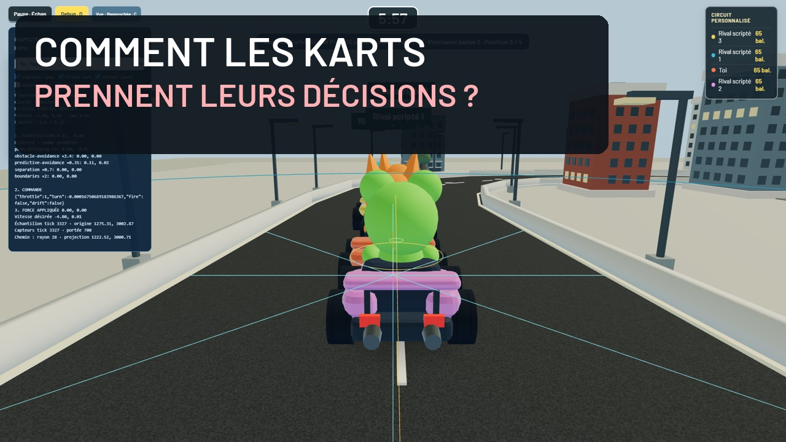

# Kart Clash · Rival Academy

**Build your track. Drive your kart. Watch your neural network learn.**

[Français](README.fr.md) · [English](README.en.md)

Kart Clash combines a 3D kart combat game, a road editor and an autonomous driving academy. Play against local bots, build tracks with bridges and tunnels, and train neural networks on your GPU. The project explores steering behaviors through a playable browser experience.

> Playing does not require CUDA. Training starts only when explicitly launched from the AI Academy. Online multiplayer is not implemented.



**[Play online](https://soubaibiomar.github.io/Kart-clash/)** · [GitHub Pages deployment](kart/GITHUB-PAGES.md)

The hosted version runs the game and editor. CUDA training requires the local setup below. Export/import JSON to transfer saved projects between the local and hosted versions.

## Features

- **Arcade Grand Prix — Turbo Cup:** races of 1–5 laps, position-based surprise items, boost pads, launch boosts and spin-outs without elimination.
- **Large circuits:** Carnaval Turbo and three Grand Tour XL layouts; larger terrain, variable road widths and adjustable buildings.
- **Arcade combat:** six item types, local bots, drifting and earned boosts in Arcade; free-for-all or core capture.
- **Custom tracks:** straights, corners, ramps, bridges, tunnels, adjustable width, handles and advanced tools.
- **City environments:** roads between buildings, multiple road levels and driving cameras.
- **AI Academy:** independent networks, border sensors, activations, fitness and a live 3D view.
- **Saved projects:** keep a goal, exact track and network together; export/import JSON.
- **Comparisons and timing:** matching-condition champion trials, manual records, sectors and compatible personal-best ghosts.

The application currently uses French interface labels. This guide includes those labels to help you find controls.

## Quick start

You need Git, Python, Node.js and a desktop browser with WebGL. No frontend framework or npm installation is required. These commands target Windows PowerShell; change the checkout path if needed.

```powershell
git clone https://github.com/soubaibiomar/Kart-clash.git C:\Kart-clash
Set-Location C:\Kart-clash
python kart/build-frontend.py
python -m http.server 8870 --bind 127.0.0.1
```

For a standalone checkout of [Kart-clash](https://github.com/soubaibiomar/Kart-clash), use its folder instead. All commands in this guide run from the directory containing `index.html` and `kart/`.

Open [Kart Clash](http://127.0.0.1:8870/dist/kart-clash/index.html#play) and keep the terminal running. Use this HTTP address instead of opening the HTML file directly: rendering uses JavaScript modules. After editing sources, run `python kart/build-frontend.py` again and reload the page.

## Controls

| Key | Action |
| --- | --- |
| Up / Down arrows | Accelerate; brake, then reverse |
| Left / Right arrows | Steer |
| Space | Use the equipped item; hold for rapid fire |
| Shift while turning | Drift; in Arcade, hold a valid drift and release Shift to earn a boost |
| C | Switch camera |
| D | Toggle diagnostics |
| Escape | Pause / resume |

Shortcuts respect text inputs. Held keys are cleared when paused or when focus is lost. Driving requires a keyboard; menus are responsive, but touch driving controls are not available.

## Play

**Chacun pour soi** is free-for-all and **Capture du noyau** is team core capture, both against local bots. Seven challenges demonstrate parking, slalom, interception, escape, escort, convoy and patrol behaviors. The Garage stores your character and color. Settings control sound, rendering quality, camera and driving profile.

Items include rockets, homing missiles, mines, rapid fire, shields and boosts. Classic and Arcade use different statistics; the HUD reads the active profile’s rules. Mines detect karts after arming and account for cover and road level.

## Choose a race and its drivers

**Jouer** opens with **Carnaval Turbo · Grand Prix**, **3 laps** and **5 scripted opponents**. **Terrain** also offers the Stadium, your saved tracks, model-embedded tracks and examples.

| Circuit mode | Opponents | Items and rules |
| --- | --- | --- |
| Contre-la-montre — time trial | None | One lap without weapons, personal timing and compatible ghosts; 3-minute limit. |
| Grand Prix arcade | Scripted bots | Surprise items, boosts and drifting; hits cause spin-outs without eliminating karts. |
| Course classique — classic race | Scripted bots and compatible saved networks | No weapons; physical contacts enabled. |
| Course combat — armed race | Scripted bots | Weapons, eliminations and respawns near the last gate. |

Set **Adversaires scriptés** from 0 to 6 and **Tours** from 1 to 5 on closed loops; open tracks use one pass. In classic races, selected networks and scripted bots share the six-opponent limit. Races end when you finish or at the track-length-dependent time limit, between 3 and 20 minutes. Standings use finish order, then the progress of unfinished rivals, rather than eliminations. Replay and restart retain your selection.

In arcade Grand Prix, collect a crate and wait for the roulette to finish before pressing **Space**. Cross boost pads or release **Shift** after a valid drift to accelerate. A fresh acceleration press within the final 0.7 seconds of the countdown, held until the start, enables a launch boost.

Network compatibility uses exact geometry, including elevations, local widths, density and terrain bounds. Renaming a track does not change compatibility. Short or obstructed starting grids are rejected: reduce the grid or adjust the road. A network trained alone may struggle in traffic; there is no hidden scripted replacement. Shared races do not save solo records. The Stadium retains its own combat modes and AI selection.

## Build a track

1. Open **Circuits**, then **Créer un circuit vide**, or load an optional example.
2. Choose a road piece, adjust its dimensions and add it. Reshape the road with handles or advanced tools.
3. Add bridges or tunnels, inspect elevations, and close the loop if wanted. Reopen a loop before extending it.
4. Use **Enregistrer mon circuit** to save, **Conduire en 3D** to drive, or **Entraîner sur ce circuit** to prepare training.

**Lire le tracé** reports 3D length, elevations, grades and corner angles. These are geometric hints, not a driveability guarantee or a racing line supplied to the AI. Terrain bounds, grades, elevation and crossing clearances remain validated.

Manual runs include timing, sectors and a personal-best ghost when a compatible recording has been retained. Records compare matching track geometry and driving settings.

## AI Academy and GPU — optional

The genetic academy follows the approach of educational example 9 from the original repository: border distances enter a network that outputs direction and speed. Progress contributes to fitness; selection, Gaussian mutations and an elite parent produce subsequent generations. Candidates own their networks and trials; they do not collide with each other.

The default genetic network has **6 inputs → 12 hidden neurons → 2 outputs**: **20 neurons** including inputs and **110 parameters**. Outputs control steering and throttle. The interface lets you inspect sensors and the network, follow trials in 3D and configure the next run. This driving network is separate from the historical combat network.

**Compute split:** CUDA runs network inference, selection and mutations. Physics, sensors and collisions use the shared JavaScript engine on CPU. Browser champion tests and comparisons run CPU inference. Increasing cycles speeds up simulated time; it does not manufacture learned speed.

### Set up the Windows service

Create the environment expected by the launcher:

```powershell
python -m venv gp/training/.venv
.\gp\training\.venv\Scripts\Activate.ps1
```

Install a compatible CUDA build using the [official PyTorch installation selector](https://pytorch.org/get-started/locally/). Run its command inside the activated environment, then verify:

```powershell
python -c "import torch; print(torch.cuda.is_available()); print(torch.cuda.get_device_name(0) if torch.cuda.is_available() else 'CUDA unavailable')"
```

In a second terminal, from the project root:

```powershell
.\kart\academy\start.ps1
```

The service listens on `127.0.0.1:8871`. In **Académie IA**, choose the track, population, sensors, hidden layers, mutations and budget, then click **Lancer la population**. Starting the service or opening the page never starts training. The older imitation/combat workshop remains separately accessible.

Local GPU validation used an RTX 4060. Other systems require their own compatible CUDA setup. Learning is experimental: completing a job does not guarantee a successful lap or generalization to other tracks.

## Save and reuse a driver

In the Academy, **Garder ce pilote pour plus tard** lets you name a project, describe a goal and save it. With a champion loaded, the project keeps the **goal, exact track, network configuration and weights** together. Without a champion, it keeps the track only.

From **Mes projets**:

- **Conduire ce circuit** starts keyboard driving on the saved road.
- **Voir mon pilote** opens the saved network’s 3D trial without training.
- **Exporter / Importer** transfers the project as JSON; imports are limited to 2 MB.

The goal text describes your intent; it does not alter fitness. A border-driving network is not a combat bot. Saving keeps the usable network, **not the full population or a checkpoint for resuming an interrupted GPU job**.

Local saves belong to the browser and HTTP origin: `localhost` and `127.0.0.1` have separate storage. Clearing browser data can erase them. Export important projects to retain them elsewhere. Duplicate project names are rejected rather than overwritten.

## Architecture

```text
index.html                 Game entry point
vehicle.js                 Protected base locomotion and steering code
kart/entities/             Entities derived from Vehicle
kart/                      Gameplay, rendering, editor, storage and AI interfaces
kart/academy/              Local API, Python training and Node workers
gp/vendor/, gp/fonts/      Rendering dependencies and fonts
libraries/                 p5.js
tests/                     JavaScript tests and Python build tests
dist/kart-clash/            Generated frontend package, ignored by Git
```

The engine separates perception, decisions, steering and locomotion. Behaviors return bounded forces, applied through `applyForce()` and inherited integration. All 22 entity classes inherit directly or indirectly from `Vehicle`; the ghost is a presentation entity excluded from collisions. UI, cameras, audio and diagnostics remain separate services.

`vehicle.js` remains unchanged. Read the [development instructions](agent.md) and [architecture](architecture.md) before modifying the engine. Historical F1, steering and snake labs remain in separate pages; they are not the Kart Clash game entry point.

## Tests

Run from the project folder containing `kart/` and `tests/`:

```powershell
node --test tests/*.test.mjs
python -m unittest discover -s tests -p test_kart_build.py
.\gp\training\.venv\Scripts\python.exe -m unittest discover -s kart/academy -p "test_*.py"
```

Latest recorded validation: **448 passing tests**, consisting of **411 JavaScript tests**, **6 Python build/deployment tests** and **31 Python Academy tests**. Academy tests require the appropriate Python environment; temporary fixtures do not launch user training.

Reports: [arcade Grand Prix](kart/TURBO-CUP-VALIDATION.md), [large circuits and racing](kart/LARGE-RACES-VALIDATION.md), [saved projects](kart/SAVED-PROJECTS-VALIDATION.md), [3D genetic learning](kart/EVOLUTION-3D-VALIDATION.md), [personal editor](kart/PERSONAL-TRACK-VALIDATION.md), [comparison](kart/COMPARISON-VALIDATION.md), [cameras](kart/CAMERA-VALIDATION.md). Detailed development reports are primarily in French.

## Troubleshooting

| Symptom | Check |
| --- | --- |
| Recent changes are missing | Rebuild the frontend and reload without cache. |
| AI service cannot be reached | Start `kart/academy/start.ps1` and check port 8871. Playing does not require this service. |
| CUDA is unavailable | Check the Python environment, PyTorch CUDA build and NVIDIA driver. |
| A save is missing | Use the same browser, address and port; import your export if needed. |
| A track is rejected | Fix the points, grades, bounds or clearances reported by the editor. |
| Rendering is slow | Select Fluide quality, reduce the displayed population or hide sensors. |

## Scope and license

Driving is arcade-style and attached to road surfaces. There is no certified automotive simulation, free-flight jumping, civilian traffic or network multiplayer. Performance and neural driving success depend on tracks, settings and hardware.

The code is distributed under the [MIT license](LICENSE). Third-party dependencies and data retain their notices: [Three.js](gp/vendor/THREE-LICENSE.txt), [fonts](gp/fonts/OFL.txt), [historical F1 circuits](gp/CIRCUIT-LICENSE.txt). Models needed by historical labs are retained; Python environments, session data and local training outputs are excluded.

## Wide avenues and narrow sections

Terrain presets are **Standard (1800 × 1400)**, **Grand (3600 × 2800)** and **Immense (5400 × 4200)**. Carnaval Turbo and the three Grand Tour XL layouts use 4500 × 3500 terrain. Enlarging terrain does not move your points; shrinking it through an existing road is rejected.

In Circuits, **Exemple : avenues et passages** loads a layout with 320-unit avenues, 140-unit narrow sections, a bridge and a tunnel. New drafts start with a 240-unit default width and 25% building density. Existing tracks keep their data.

**Largeur à l’arrivée** controls new pieces. **Largeur au point choisi** adjusts an existing handle from 120 to 320, with a gradual transition between points. **Bâtiments** adjusts density from 0 to 100%. Rendering, boundaries, supports, sensors and road constraints share these settings across the editor, game and Academy workers. Changed widths distinguish records and compatible models; saved models are never silently updated.

## Video demonstration

The **French V4 demonstration runs for 6 min 17** at 1080p, with narration, subtitles and eleven chapters covering driving, steering, sensors, force composition, neural networks, genetic evolution, the Academy, 3D construction and arcade Grand Prix.

In the development workspace, files are stored under `C:\SteeringBehaviours\exports\youtube-kart-clash-20261020\v4\`:

- `Kart-Clash-Demonstration-Commentee-V4-FR.mp4`: final edit.
- `Sous-titres-FR-v4.srt`: separate French subtitles.
- `Publication-YouTube-V4.md`: proposed title, description and chapters.
- `Validation-V4.md`: editing validation report.

The video has not been published on YouTube, and video files are not included in this project folder. The demonstration includes actual saved-model trials and explains training configuration; no new GPU training was launched for filming.
