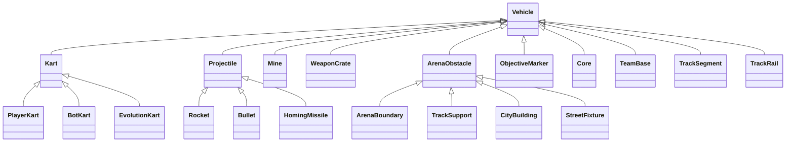

# Architecture — Kart Clash

## Comparaison des champions génétiques

`EvolutionComparison` valide deux réseaux border-rays-v1, puis clone leurs données avant de créer deux EvolutionPopulation à un candidat. Chaque candidat reste un EvolutionKart → Kart → Vehicle, avec les capteurs et la physique partagés. Les topologies peuvent différer ; géométrie, largeur, altitudes, départ, graine, budget, stagnation et limite de vitesse sont communs. La limite n'excède pas le minimum des deux profils. Les données des modèles d'origine ne sont jamais réécrites.

Les ticks de simulation sont fixes et les métriques viennent des essais : progression, état d'arrêt, temps, vitesse courante/moyenne/pointe. Le temps de fin d'un candidat reste figé pendant que l'autre continue. L'écart B − A n'est produit que pour deux arrivées. Pause et visibilité réinitialisent l'accumulateur ; arrêt manuel conserve un résultat partiel explicite. Le rapport JSON kart-comparison-v1 contient les conditions effectives et les résultats mesurés, sans prétendre être un modèle ou une preuve d'amélioration générale.

`ComparisonPanel` ajoute l'entrée Comparer deux modèles dans l'Académie génétique. Les sources sont le champion courant, la révision précédente reçue en mémoire, les champions enregistrés et deux imports JSON validés (2 Mo maximum). Le bouton seul lance l'essai ; il n'appelle jamais l'API de calcul. Pendant un calcul du service, l'essai local se suspend et nécessite une reprise explicite. L'apprentissage CUDA existant reste séparé.

Les deux EvolutionView ont leurs propres mondes d'affichage et interpolent les instantanés locaux sans modifier les mondes d'essai. Les karts arrêtés restent visibles à leur dernière position mesurée dans cette comparaison, avec leur cause d'arrêt affichée. IntersectionObserver coupe uniquement le dessin des vues hors écran, sans fabriquer ni interrompre les résultats physiques. Les ressources se libèrent à la sortie. Voir `kart/COMPARISON-VALIDATION.md`.

## Caméra de conduite et dégagement

`race-camera.js` calcule un cadrage poursuite/rapproché/haut à partir de la position, du cap et de la vitesse mesurés. Le recul (75–150 %) et la réactivité (50–200 %) sont persistés dans KartStorage ; C et le bouton HUD partagent le même changement de vue. Une anticipation latérale du regard suit la commande de virage ; en marche arrière, le regard se raccourcit vers l'arrière. Les mouvements réduits retirent anticipation, interpolation et variations de cadrage liées à la vitesse. Les vues de menu et de survol de population restent séparées.

Le dégagement mesure l'intersection 3D entre l'œil du kart et la position de caméra. Les bâtiments/obstacles utilisent leurs volumes physiques ; les rails sont transformés dans leur repère orienté avec pente. Les tabliers, plafonds et murs de tunnels utilisent leurs meshes existants marqués cameraSolid, sans nouvelle géométrie physique ni entité. Cinq rayons bornés donnent une marge autour de la caméra. Le même contrôle après lissage empêche de traverser une coque lors d'un virage ou d'un changement de hauteur. La hauteur souhaitée baisse dans un tunnel ; le vrai test de coque reste actif en entrée et en sortie.

Les poteaux décoratifs de balises de circuit se masquent uniquement lorsqu'ils interceptent le segment de vue vers le kart. Leur anneau au sol, leur entité Vehicle, leurs checkpoints et leur perception restent inchangés. Aucun calcul de caméra ne modifie position/vitesse/forces ni état des réseaux. Voir `kart/CAMERA-VALIDATION.md`.

## Raccord de boucle en édition

TrackConnector est un service géométrique sans état physique. Une courbe cubique relie la fin au départ, avec deux courts segments exactement tangents aux portions existantes. L'amplitude (80–700) change les poignées de la courbe ; un rééchantillonnage par distance évite de multiplier les points près des extrémités. Les altitudes sont interpolées sur la longueur du raccord. KartTrack.validate impose les mêmes limites que les circuits enregistrés ; un contrôle local supplémentaire refuse un rayon inférieur à la demi-largeur + 25.

Le résultat expose un circuit fermé et un aperçu détachés du brouillon. TrackBuilderView réserve les parcelles urbaines à partir de ce circuit proposé, puis dessine uniquement les nouvelles portions en bleu, y compris le dernier segment vers le départ. Ce rendu est un diagnostic. Après ajout, TrackArena construit les TrackSegment/TrackRail/TrackSupport héritant de Vehicle comme pour tout autre circuit. Ni locomotion ni observations des réseaux ne changent. L'ajout est atomique, annulable et réévalué au clic ; les formats d'export et le lien vers l'Académie restent identiques. Voir `kart/TRACK-CONNECTOR-VALIDATION.md`.

## Conduite et combat versionnés

`KartGameplay` est un service, pas une entité. Il calcule une vitesse désirée et retourne `desiredVelocity - velocity`, limitée par `maxForce`. `Kart.drive` conserve une seule application de force et une seule mise à jour héritée de Vehicle. Le profil Arcade amortit le volant et l'adhérence, freine jusqu'à l'arrêt avant une temporisation de marche arrière et limite celle-ci à 40 % du plafond. Un drift valide de 0,8 seconde prépare un turbo de 0,75 seconde, attribué au relâchement de Maj. Les durées sont en temps simulé ; pause et respawn annulent la charge.

Le service fournit aussi les définitions d'armes du profil au moteur, aux entités Projectile/Mine et au HUD. Les avertissements sont une lecture séparée de menaces existantes avec filtrage du couvert, de l'étage et des échéances. Les entités physiques continuent à hériter de Vehicle ; aucune nouvelle locomotion ni classe d'entité n'est ajoutée.

La propriété optionnelle `gameplay` distingue `kart-classic-v1` et `kart-arcade-v2` sans changer la topologie ni les observations/actions des réseaux. Une absence signifie Classique pour les anciens modèles et démonstrations. Le modèle impose ses règles à KartWorld et TrainingTrial ; une demande contradictoire est refusée par l'évaluateur. Les nouveaux travaux de l'atelier Académie choisissent leur profil et le conservent dans l'export. Une démonstration d'un autre profil est refusée. L'interface vérifie la capacité `gameplayV2` du service ; aucun travail ne démarre au chargement. Le laboratoire génétique à deux sorties reste inchangé. Voir `kart/ARCADE-GAMEPLAY-VALIDATION.md`.

## Combat et rendu des armes

`KartWeapons.availability()` est le contrat commun de validation des usages pour le moteur et le HUD : vie, pause, phase, munitions, capacités, cadence et place disponible pour une mine. Un refus ne consomme ni munition, ni délai, ni protection. Le premier balayage d’un Projectile inclut le segment entre le centre du tireur et la sortie du canon, afin de ne pas traverser un mur proche. La locomotion utilise toujours une seule mise à jour héritée. HomingMissile conserve pursue borné et ignore les alliés ; projectiles et mines ne sont pas consommés par un coéquipier. Une mine armée garde le droit de toucher son propriétaire, filtre les étages et exige une ligne de vue dégagée. Les statistiques et dégâts proviennent du même moteur dans le navigateur et les workers ; topologie et schémas des réseaux restent inchangés.

`kart/weapon-art.js` construit les modèles originaux des projectiles et les accessoires de l’arme équipée sur chaque Kart. Ces meshes décorent les entités Vehicle existantes. Le rayon affiché d’une mine est celui de sa détection ; son état d’armement est lu depuis l’instantané de perception. `kart/combat-effects.js` anime impacts, fumée et étincelles à partir des événements réels et du temps de simulation. Les effets sont limités à 32, sans lumière dynamique supplémentaire ni consommation de RNG. Les matériaux propres aux mines/effets sont libérés à leur retrait ; les géométries et matériaux communs restent mutualisés. Le renderer utilise des matériaux Standard avec rugosité/métallicité respectées, un asphalte texturé à l’échelle du terrain et des ombres de contact adoucies. Les réglages de mouvements réduits restent applicables.

Rapport : `kart/COMBAT-GRAPHICS-VALIDATION.md` ; tests ciblés : `tests/kart-combat-fixes.test.mjs`, `tests/kart-weapon-art.test.mjs`.

## Rues entre les bâtiments

`CityLayout.plan()` place d’abord les façades à intervalles de distance le long des deux côtés du tracé personnel, puis remplit les îlots arrière. L’ajout de points colinéaires ne densifie pas artificiellement les façades. La génération ne change aucun point de route, ne consomme pas le RNG du monde et conserve un dégagement de 36 unités au-delà du disque englobant chaque bâtiment, pour toutes les projections des chaussées. Les bâtiments gardent 12 unités entre leurs empreintes rectangulaires ; le nombre reste borné à 240, les échantillons de rue à 180. Les placements incompatibles avec un virage ou un autre passage sont omis, jamais forcés sur la chaussée.

`CityBuilding extends ArenaObstacle extends Vehicle` copie la métadonnée `frontage` du plan ; `city-art.js` l’utilise uniquement pour orienter portes et auvents vers la rue. Les mêmes instances physiques alimentent rendu et capteurs dans la partie, l’essai local et le worker commun. L’éditeur utilise le même plan. Les tracés et modèles sauvegardés ne sont pas réécrits. Tests ciblés : `tests/kart-street-frontage.test.mjs` ; rapport `kart/STREET-FRONTAGE-VALIDATION.md`.

## Affichage des armes

`kart/weapon-display.js` sépare la lecture de l’état (`weaponDisplayState`) et le panneau DOM (`WeaponDisplay`). Les six illustrations originales ne sont pas des entités physiques. Le panneau lit l’objet équipé, les munitions, `fireAt`, les limites de capacité et les échéances de bouclier/turbo du monde ; il ne déclenche aucun tir et ne modifie aucun véhicule. Les effets actifs sont affichés indépendamment de l’emplacement d’objet, avec leur durée réelle. L’illustration et les éléments de jauge restent stables entre les mises à jour du HUD ; les annonces vocalisées sont limitées aux changements d’équipement/élimination. Le panneau reste masqué dans les essais de circuits personnalisés. Tests : `tests/kart-weapon-display.test.mjs`.

L’entrée principale `index.html` charge p5.js, le `vehicle.js` fourni, les gestionnaires de comportements réutilisables et les modules `kart/`. Elle ne charge aucun pilote, règlement ou modèle F1. Les pages historiques sont conservées. Les limites de modification de la racine restent applicables.

## Héritage et frontières

Un fichier par entité dans `kart/entities`. Les meshes lisent ces entités et ne déplacent jamais le monde. KartArena (géométrie et A*), KartCollision, KartPerception, KartWeapons, KartChallenge, CombatBrain, KartStorage, UI, caméra et audio sont des services. Les particules non interactives et les bâtiments extérieurs sont du rendu.

`KartWorld` sélectionne les actions. Les bots perçoivent, choisissent collecte/chasse/fuite/récupération, composent des forces avec BehaviorManager et SteeringBehaviors, puis convertissent la direction souhaitée en commandes de volant. `Kart.actionForce` convertit ces commandes en vitesse désirée, calcule desiredVelocity − velocity et borne la force. `applyForce` puis `super.update()` intègrent une fois par tick. Les projectiles suivent le même contrat ; le missile réutilise pursue. Les entités statiques ont vitesse et force nulles. Aucun déplacement autonome n’est codé comme une suite de positions.

Spawn/respawn sont des transitions explicites. KartCollision corrige ensuite les pénétrations et vitesses normales dans une phase de contacts distincte. Le balayage des projectiles compare le premier contact segment/rectangle et segment/cercle, puis applique un seul impact. Les projectiles expirés et les cibles mortes ne causent pas de double score.

## Temps et ressources

Pas fixe 1/60 s, maximum 12 ticks de rattrapage. Une image longue consomme le surplus dans les horloges actives sans déplacement supplémentaire, afin que la manche conserve sa durée réelle. Pause et perte de focus figent horloges, réapparitions et effets ; les touches sont effacées. Le retour à un nouveau monde détruit les anciennes références, réinitialise debug/caméra et vide les voix. Géométries et matériaux répétitifs sont mutualisés ; la remise à zéro et pagehide libèrent les ressources non partagées. Le renderer ne possède aucune locomotion.

Le navigateur affiche une caméra de poursuite amortie, raccourcie devant les volumes de couverture. Après respawn, son suivi est réinitialisé. Mouvements réduits désactive l’interpolation et les oscillations de caisse. L’audio Web Audio est original, activé après un geste ; volume, silence, pause, onglet et restart sont respectés.

## Comportements et navigation

Les forces réutilisables restent indépendantes dans `gp/steeringBehaviors.js` et `kart/behaviors.js`. Seek/arrive : caisses et guide de parking. Pursue : chasse et missile. Flee : bot blessé. Evade : menace projetée. Wander : variation continue. Path following : waypoint courant d’un A* sur grille 70 px. Évitement statique : rayons locaux ; priorité sur l’objectif quand le mur devient urgent. Évitement prédictif et séparation : voisins en mouvement. Alignement/cohésion/leader following : escorte. Arrive en chaîne : convoi serpent. Boundaries : limites de l’arène. Le debug lit les diagnostics composés ; il ne recalcule pas les forces.

A* fournit une suite d’objectifs, jamais une animation de positions. Rayons, contacts et A* utilisent les mêmes rectangles physiques. Les bots réévaluent les buts expirés et lancent une récupération en marche arrière s’ils ne progressent pas pendant deux secondes. Le contrôleur neuronal est explicitement séparé du contrôleur scripté et n’utilise pas cette récupération en secours.

## Combat neural v1

JSON `schema=kart-combat-v1`, `normalization=local-v1`, nom, configuration, couches denses avec poids à plat en ordre entrée/sortie, biais et métadonnées. 5–17 capteurs, 100–400 px, 1–3 couches cachées de 4–64 neurones. Tanh ou ReLU caché, sorties tanh. Validation côté UI, Python et inférence. Aucun fichier apex-driver-v1 accepté.

Observation : N distances de murs, réparties sur un cercle de −π à π (extrémités arrière redondantes), normalisées par la portée et tenant compte du rayon du kart. Puis **21 valeurs**, dans l’ordre :

1. Vitesse longitudinale / 8 ; sinus et cosinus du cap.
2. Position relative adverse longitudinale/latérale / 700 et indicateur de présence ; vitesse relative longitudinale/latérale / 10.
3. Menace projectile : position relative longitudinale/latérale / 700 et présence.
4. Caisse disponible : position relative longitudinale/latérale / 700 et présence.
5. Vie / 100 ; type d’objet (vide=0, puis ordre rocket, homing, mine, rapid, shield, boost / 6) ; munitions / 10 ; recharge restante bornée à 1 s ; bouclier, turbo, protection (booléens).

Tout est borné dans [−1,1]. Un objet absent donne trois zéros. L’adversaire est perçu à 700 px, la menace à 260 px ; la caisse la plus proche peut être plus loin et ses coordonnées sont bornées. Sorties : direction, accélération/freinage, propension au tir (tir si >0,25). Mêmes commandes bornées que le joueur. Les neurones comptés incluent les entrées ; les biais sont des paramètres, pas des neurones.

## Apprentissage, export et différence matérielle

Le service facultatif `kart/academy/server.py` n’accepte que le loopback et les origines locales prévues. GET ne démarre jamais de tâche. POST valide les limites, refuse un second calcul et crée un dossier UUID. Stop et budget interrompent aussi le sous-processus d’évaluation. L’export achevé reste atomique ; aucun modèle fourni n’est écrasé.

Node `evaluate.cjs` charge les mêmes sources de Vehicle, combat, rayons, contacts et actions que le navigateur, avec un adaptateur arithmétique du sous-ensemble p5.Vector. L’adaptateur ne recopie pas la locomotion. Les démonstrations proviennent de commandes réellement exécutées par les bots. Python/PyTorch entraîne les couches et crée les mutations sur CUDA ; **le rollout physique et l’inférence d’évaluation sont sur CPU**, contrairement à l’ancien moteur F1 tensorisé. Le navigateur infère en nombres JavaScript ; CUDA est float32 (parité testée à 1e−5).

Évolution élitiste (1+λ) : conserver le meilleur parent, générer des mutations gaussiennes, comparer la moyenne des deux dispositions aux mêmes graines à chaque génération. Validation distincte avec graine seed+911. Trois adversaires scriptés, sans multijoueur. La population ne partage pas un espace interactif : chaque candidat joue son propre rollout.

Fitness = 10×éliminations + 0,04×dégâts infligés + 0,01×secondes de survie + 0,002×secteurs visités − 5×morts − 0,02×dégâts reçus − 0,02×tirs sans effet − 0,02×ticks de contact − 0,01×secondes immobiles − 0,5×circulation inefficace. Circulation inefficace : >400 px parcourus en moins de quatre secteurs distincts (150 px). Réussite : validation avec ≥1 élimination, ≥80 dégâts, ≤2 morts. Un budget épuisé n’est pas une preuve d’apprentissage réussi.

Évaluation courte configurable 120–1800 ticks, contre manche réelle 180 s ; mêmes règles mais horizons différents. L’imitation seule ne valide pas le combat. Les métriques affichées proviennent des sorties mesurées, sans courbes ni activations fabriquées. Preview : candidat sélectionné de la dernière population évaluée, diagnostic 2D statique. Pas de population 3D animée de l’Académie dans cette version. Le jeu normal reste pleinement 3D et indépendant du service.

## Fichiers et validation

Créés : `kart/` (entités, simulation, interface, rendu, audio, stockage, cerveau, worker/API/tests Academy et empaquetage), `tests/kart.test.mjs`, `tests/kart-render-audio.test.mjs`, `apex-lab.html`, `PRODUCT.md`, `DESIGN.md`, `KART-CHECKLIST.md`, `SNAKE-LAB.md`, `gp/ARCHITECTURE-HISTORY.md`.
Modifiés : `index.html`, `README.md`, `architecture.md`, `agent.md`, liens historiques `garage.html`, `training.html`, `gp/garage.js`, `gp/workflow-ui.js`, références d’entrée des tests historiques `tests/neural.test.mjs` et `tests/visual3d.test.mjs`.

Les commandes, résultats et scénarios de contrôle sont dans `kart/VALIDATION.md`. Le SHA-256 de vehicle.js reste A13B9EF7092EF2E15839F253A18C79A41B0530AC53D46BB4A6669A29D0CA9B4B. Les anciens modèles gp/models restent intacts.

## Révision toy-v2

`kart/inspection.js` porte la politique clavier (`KartInput`) et l’état unique du debug (`KartDebug`). Il ne calcule ni perception ni force. Kart et Projectile capturent avant locomotion l’origine, la vitesse désirée et la force bornée ; le renderer lit ces copies. BotKart utilise une perception unique pour son contrôleur ; CombatBrain observe avec sa configuration de capteurs et conserve ce relevé. Les cibles de collecte sont limitées à 700 px.

L’évitement statique est calculé une seule fois dans la planification. Lorsqu’il détecte un obstacle urgent, sa force bornée remplace la somme normale, et le diagnostic porte cette force prioritaire. La commande convertit ensuite la planification en volant/accélération ; elle n’est pas confondue avec la force finale de locomotion.

Le chemin A* reste une source de segments. Le véhicule projette sa position prévue à dix ticks sur le segment courant ; le corridor a un rayon de 28 px. Dans le corridor il suit la tangente, hors corridor il rejoint un point à 35 px devant la projection ; il ralentit près du waypoint. Le debug montre prédiction, projection, rayon et cible. La trajectoire n’est jamais appliquée directement à la position.

La caméra lit seulement le monde. Son recul nominal est de 240 px, avec rapprochement devant le couvert et contrôle de la position interpolée. En marche arrière, le regard se rapproche derrière le centre du kart sans retournement instantané. La prévisualisation utilise une horloge de rendu séparée, sans simuler un entraînement ni déplacer les entités.

L’Académie évalue un bot scripté de référence sur les graines/layouts identiques aux trois scénarios du candidat (dont la validation réservée). Les métadonnées exportées incluent baseline, scénarios, dégâts reçus/infligés, contacts par tick, secteurs et distance. Les comparaisons ne s’affichent qu’avec les résultats réels. Les anciens modèles gardent un schéma compatible mais doivent être réévalués avec la conduite révisée.

## Rival Academy — révision actuelle rival-v3

Cette section remplace les contrats v1/toy-v2 décrits plus haut. CombatBrain conserve son architecture dense configurable, avec quatre sorties (direction, accélération, tir, drift) et schéma kart-combat-v2. L'observation local-v1 garde N+21 valeurs ; les ennemis et menaces doivent être visibles. Les anciens cerveaux sont conservés mais rejetés à l'exécution. Un seul adversaire neuronal est sélectionné, sans secours scripté. Les modes équipe et défis utilisent les contrôleurs dédiés.

Core et TeamBase héritent directement de Vehicle, dans des fichiers séparés. CaptureCore sélectionne les rôles et règle attachement/chute/livraison, sans dupliquer la locomotion des karts. Les objectifs sont publics aux équipes ; l'attaque reste locale et vérifie la ligne de vue. Une flèche HUD indique le noyau ou la base.

Kart porte le drift : adhérence latérale visée 0,94 contre 0,25 normalement, seuil 2 px/tick, braquage >0,15, direction ×1,35. Vitesse désirée et force bornées ; toujours un applyForce et un super.update. Limites de vitesse/force normales inchangées, restauration exacte du turbo. Pause et respawn retirent le drift.

KartDemonstration n'existe qu'après choix explicite. Une observation tous les six ticks actifs et vivants, puis la commande de ce même tick ; aucun état de menu/pause. Contrats versionnés validés en JavaScript et Python, 1800 relevés maximum, stockage local unique exportable/supprimable. CUDA apprend les commandes ; séparation chronologique 80/20 avec 60 ticks exclus. La métrique de validation d'imitation est distincte de la validation combat. L'évaluation CPU explicite est bornée et ne sauvegarde ni ne lance d'apprentissage.

Voir kart/RIVAL-VALIDATION.md pour les tests et limites de livraison.

## Éditeur et entraînement sur circuit

- `kart/tracks.js` : schéma kart-track-v1, validation, géométrie des segments, portions et stockage local.
- `kart/track-editor.js` : contrôles DOM et dessin de diagnostic ; ce ne sont pas des entités physiques.
- `kart/track-arena.js` : sous-classe de KartArena, construit des ArenaObstacle héritant de Vehicle. Les mêmes rectangles alimentent rendu, perception, routage et collision.
- `kart/track-trial.js` : état de progression et balises ObjectiveMarker héritant de Vehicle. Positionnement direct uniquement au départ ; la conduite conserve applyForce et la locomotion de Kart/Vehicle.
- `kart/world.js` et `kart/app.js` : sessions manuelles ou neuronales, reprise du circuit, HUD et navigation.
- `kart/brain.js` : réseaux kart-track-v1 / track-local-v1, distincts de kart-combat-v2. Les observations de but visent la prochaine balise ; les autres capteurs restent réels. Aucun repli du réseau vers le pilote scripté.
- `kart/academy/{evaluate.cjs,train.py,server.py}` et `kart/academy-ui.js` : choix du circuit, démonstrations scriptées, fitness progression/contacts, export du tracé et test 3D. Capacité API tracks requise avant un lancement circuit.

Le moteur physique fourni vehicle.js reste inchangé. Les modifications des circuits après sauvegarde ne modifient pas un cerveau déjà exporté. Les noms de circuits affichés sont échappés et les imports validés.

## Présentation arcade Stadium
`kart/arcade-art.js` dessine les volumes aux dimensions des ArenaObstacle/ArenaBoundary existants ; tribunes et collines restent hors de l’aire physique. `kart/arcade-view.js` expose des lectures pures de caméra, inclinaison et visibilité des plaques. `renderer.js` applique ces lectures, projette la visée, borne les particules à 32 groupes de neuf meshes au maximum et mutualise leurs géométries. Aucun RNG du monde ni force n’est calculé par ces modules. La caméra vérifie la hauteur à l’entrée du couvert après amortissement. `app.js` lit les événements hit/elimination pour la confirmation et le +1 ; aucun score n’est accordé par l’UI. `audio.js` spatialise les cues si StereoPanner est disponible et déconnecte ces nœuds à l’arrêt. Tests : tests/kart-arcade.test.mjs et tests/kart-render-audio.test.mjs. Les règles de simulation restent celles de rival-v3.

## Construction 3D — schéma kart-track-v2

Cette section remplace les limitations plates décrites pour la première version de l’éditeur. `KartTrack` valide et conserve les altitudes/types, fournit portions, coins biseautés et supports. `TrackSegment extends Vehicle` porte un tablier ; `TrackRail extends Vehicle` un garde-corps incliné ; `TrackSupport extends ArenaObstacle` un pilier. Chaque classe a son fichier. `TrackArena` garde le traitement v1 et construit ces entités pour les circuits v2. `TrackSurface` choisit uniquement les segments adjacents près de leur raccord, interpole l’altitude, puis résout le contact de bord après la locomotion. Aucune position horizontale de conduite n’est animée par le circuit. `KartCollision` traite rails orientés et ignore les contacts entre étages séparés. Les capteurs utilisent `solidsFor` sur le niveau pertinent. Les balises vérifient aussi l’altitude.

`TrackBuilderView` est un service d’édition WebGL : raycast, plan de dessin, déplacement, orbite et zoom. Ses poignées sont des contrôles de diagnostic, pas des véhicules de course. `TrackEditor` gère l’état, l’historique et les contrôles. `track-geometry.js` est partagé par le jeu et l’éditeur ; coins/rails/piliers proviennent des mêmes calculs que les colliders. Le renderer lit altitude et pente pour le kart, garde la caméra dans le tunnel, et détruit le viewport éditeur au départ/à la navigation.

Le cerveau `kart-track-v2` conserve N+21 entrées et quatre sorties ; la normalisation `track-deck-v2` explicite la perception par niveau. V1 reste compatible avec son propre schéma. Validateurs Python/JS, exports et worker sont alignés. La capacité API tracks3D empêche un lancement sur un ancien service. Le bot de référence ralentit dans les virages et traite les garde-corps latéraux à un seuil adapté ; cela ne s’applique qu’aux nouvelles routes avec tabliers.

`Mine.detect` porte l’armement, le rayon 46, le filtre vertical et le relevé de détection. KartWeapons consomme cette cible, retire la mine et applique les dégâts existants une seule fois. Le cercle de rendu lit le rayon réel, sans recalculer les forces ou consommer le RNG. Sa pulsation modifie la transparence, pas le rayon. Le rendu du monde est suspendu derrière l’éditeur pour éviter deux scènes animées inutilement. Tests et limites : kart/3D-TRACKS-VALIDATION.md.

## Essai neuronal 3D et progression de vitesse

`kart/training-trial.js` porte une simulation locale indépendante du calcul : il utilise KartWorld, CombatBrain et les mêmes entités héritant de Vehicle. Avant un modèle, le circuit est immobile. Les poids d’un nouveau checkpoint remplacent le réseau sans modifier position, vitesse ou horloge ; un circuit différent ou un essai terminé démarre une nouvelle session. Pause et reprise restent explicites. Aucun appel d’apprentissage n’est effectué par ce service.

`kart/training-camera.js` cadre la totalité du circuit sans modifier le monde ; la vue peut basculer vers la caméra de poursuite. `kart/training-drive-view.js` associe ce service au renderer Three.js, affiche la vitesse mesurée en px/s, plafond, contacts et progression. Les changements de page détruisent renderer, observateurs et animation ; un onglet masqué suspend les ticks. `academy-ui.js` reçoit les checkpoints d’imitation et de génération via les API existantes. Cette vue est un essai d’inférence distinct des rollouts de validation CPU, et l’indique. Le rendu du menu derrière l’Académie est suspendu.

`kart/track-pace.js` valide le profil exporté `driving: {schema: "track-pace-v1", maxSpeed}` ; sans profil, le plafond historique reste 4.8. Ce profil règle les limites de Kart ; il n’ajoute ni moteur de mouvement ni commandes scriptées au réseau. Le schéma des observations ne change pas. `kart/academy/pace.py` exige deux générations consécutives dont les trois scénarios terminent le tour, avec contacts/tick <= 0.035 et immobilité <= 2 s. Le plafond suivant est appliqué à la génération suivante ; le modèle exporté conserve le plafond réellement évalué. Le parent et les références sont réévalués à cette vitesse. `track-laptime-v1` ajoute une récompense de temps à la fitness circuit. L’apprentissage et l’atteinte du plafond cible ne sont jamais garantis. Les capacités API adaptivePace/trainingView protègent contre un ancien service. Détails et preuves : kart/TRAINING-LIVE-VALIDATION.md.

## Sessions et cohérence des écrans
`kart/session.js` prépare et valide un nouveau KartWorld avant que l’application ne libère l’écran courant ; une erreur ne détruit pas l’éditeur ou l’Académie. `academy-state.js` associe un modèle à son tracé exact et réserve un espace de valeurs distinct pour les circuits sauvegardés. Les imports non sauvegardés restent utilisables sans écriture automatique. AcademyPanel centralise l’état occupé et le verrouillage des commandes ; le polling ne modifie pas un démarrage en cours. La navigation interne de l’Académie ne change pas la route du jeu. Les projectiles conservent leur altitude et les impacts filtrent les étages. La locomotion de Vehicle reste intacte. Voir kart/UX-BUGFIX-VALIDATION.md pour le parcours utilisateur, l’audit des 17 entités et les tests.

## Assemblage paramétrique du circuit
`kart/track-pieces.js` fournit TrackPieces.append, service pur de géométrie : lignes, arcs à tangentes exactes, rampes, ponts et tunnels. Il conserve le schéma kart-track-v2 et ne pilote pas les entités. TrackEditor possède les dimensions, l’historique d’annulation/rétablissement et la fermeture du circuit ; TrackBuilderView reçoit un aperçu et le dessine comme diagnostic bleu sans mutation du tracé. Un ajout reprend le cap géométrique réel de la dernière portion ; aucune métadonnée de cap incompatible n’est nécessaire après sérialisation. Les routes physiques restent les sous-classes existantes de Vehicle. Les modèles sauvegardés conservent leur ancien tracé et ne sont pas modifiés par les changements de l’éditeur. Validation : kart/TRACK-ASSEMBLY-VALIDATION.md.

## Population génétique 3D — track-evolution-v1

`EvolutionKart`, fichier propre dans kart/entities, hérite de Kart puis Vehicle. Il convertit deux sorties neuronales en vitesse désirée puis force bornée ; Kart.drive applique la force et délègue l’unique update à Vehicle. `EvolutionBrain` valide kart-evolution-v1 / border-rays-v1 : 5–17 rayons avant, 1–3 couches cachées configurables, deux sorties tanh. Par défaut 6→12→2, soit 20 neurones et 110 paramètres. Il perçoit uniquement les garde-corps/obstacles à l’étage utile via solidsFor ; aucune cible, checkpoint ou ligne de course dans les entrées.

`EvolutionPopulation` orchestre des essais indépendants dans un TrackArena commun. TrackTrial conserve les balises ordonnées et le départ. TrackSurface et KartCollision résolvent la route/les contacts après la locomotion. Contacts, stagnation et budget terminent un candidat ; aucune réapparition. La fitness réunit balises, progression partielle bornée et bonus d’arrivée/temps, sans force scriptée. Les karts ne s’évitent pas entre candidats, car chaque modèle est évalué indépendamment.

`academy/evolution-world.cjs` charge les mêmes sources dans Node et échange des observations/actions par JSON-lines. `academy/evolution_train.py` réalise les inférences batchées, la roulette stable normalisée de 2^fitness et les mutations gaussiennes sur CUDA ; un élite exact est conservé. Les contraintes et actions sont identiques au navigateur. Les nouveaux modèles et relevés sont atomiques et séparés du mode imitation. Chaque nouveau lancement génère une population aléatoire ; le champion sauvegardé est destiné au test/export. Aucun apprentissage automatique à l’ouverture.

`server.py` dispatch selon algorithm et expose evolution3D, /api/evolution et /api/evolution-model. Les UUID sont validés ; l’export de candidat exige la génération attendue afin de ne pas exporter un successeur accidentellement. --resume-status restaure uniquement un calcul terminé, sans worker. Le verrou existant interdit les entraînements simultanés des deux ateliers.

`evolution-ui.js` et `evolution-view.js` sont des services. Le renderer simplifié dessine jusqu’à 100 karts 3D, sur les altitudes reçues. Le flux représente les états physiques réels du worker avec interpolation de présentation ; aucune trajectoire inventée. Caméra générale/poursuite, sélection, capteurs déjà calculés et réseau/activations sont inspectables. Le test d’un champion sauvegardé utilise EvolutionPopulation.neuralStep localement sur CPU et est identifié comme tel. Le retour au flux reconstruit la bonne population. Les vieux modèles et pages F1 restent séparés. La vitesse physique est plafonnée pendant un calcul ; le réglage des cycles ne change que son rythme. Rapport : kart/EVOLUTION-3D-VALIDATION.md.

## Quartiers urbains et géométrie routière

CityTracks est un catalogue de trois routes fermées v2 : Centre-ville (60 points), Les docks (75 points) et Métropole (60 points, viaduc et tunnel). Les virages sont des arcs circulaires tangents ; leur rayon tient compte des segments disponibles. Ils restent des données éditables, jamais une trajectoire appliquée aux voitures. TrackEditor charge le quartier avec historique d’annulation/rétablissement ; EvolutionPanel expose les mêmes presets et les circuits sauvegardés. Les anciens fichiers de tracé et de modèle restent inchangés.

CityLayout crée un plan de parcelles et d’accessoires hors du corridor routier élargi. Sa géométrie déterministe ne consomme aucun KartRandom. TrackArena crée CityBuilding et StreetFixture (ArenaObstacle → Vehicle), ajoute leurs colliders avec filtrage vertical, et conserve les instances pour le rendu. Les arbres et lampadaires sont statiques ; aucune circulation civile ou piéton n’est simulé. Le fond et le marquage restent du rendu des tabliers existants.

City-art utilise des matériaux Standard rugueux, une texture d’asphalte procédurale et des InstancedMesh regroupés par couleur pour les bâtiments, fenêtres, toitures et accessoires. Les ressources d’instances sont libérées avec les géométries ; les textures sont libérées avec leurs matériaux. TrackBuilderView peut masquer le décor sans modifier la piste sauvegardée ni sa physique. Track-geometry construit trottoirs et coques de tunnel à partir des mêmes offsets que les rails, avec UV et sous-face. Les balises des tracés denses sont des marques discrètes dans le jeu ; toutes restent actives pour la progression.

KartBehaviors.roadAvoid conserve une force bornée, basée sur le capteur de danger avant le plus proche. Les rayons arrière et le décor derrière ne décident plus du côté d’évitement. Le pilotage neuronal garde ses observations et ses commandes indépendantes. Aucun modèle n’est remplacé par ce pilote de référence.

EvolutionPopulation ajoute les données de tablier et pente aux instantanés. EvolutionView les applique aux seuls objets d’affichage, sans mise à jour physique supplémentaire. EvolutionPanel conserve un état de préparation pour éviter qu’un relevé ancien ne remplace le circuit choisi ; le bouton Flux du calcul reprend explicitement l’observation. Un nouveau démarrage efface les anciennes poses. Validation et limites : kart/URBAN-TRACKS-VALIDATION.md.

## Conception personnelle du tracé
TrackEditor.empty() fournit un brouillon v2 vide et ouvert ; un circuit sélectionné existant reste conservé. newDraft() crée un nouveau brouillon annulable, sans supprimer de sauvegarde. Le chargement d’un exemple est facultatif et replié. La palette expose les six portions et réutilise TrackPieces ; ne dupliquer ni géométrie ni locomotion. Une boucle fermée doit être rouverte avant un ajout, pour ne pas modifier silencieusement son raccord. Nom, largeur et sauvegarde sont visibles ; l’assemblage reste le mode par défaut, distinct de l’ajout de points ou du dessin libre. Les ponts/tunnels continuent d’utiliser TrackSegment, TrackRail et TrackSupport héritant de Vehicle. Aucun changement de vehicle.js. Tests ciblés : tests/kart-personal-editor.test.mjs ; rapport kart/PERSONAL-TRACK-VALIDATION.md.

## Aperçu de construction entre les façades
`kart/construction-view.js` compose une copie de la route et de la portion proposée pour réserver leur corridor dans CityLayout. TrackBuilderView utilise cette copie pour le décor, dessine une chaussée bleue de pleine largeur et garde les tabliers réels sur le brouillon. Les caméras de cadrage/rue ne modifient ni tracé ni physique ; la vue de rue se rapproche avant une façade. Les anciens matériaux de grille sont libérés à chaque reconstruction, les matériaux mutualisés sont conservés. Les bâtiments physiques restent les sous-classes existantes de Vehicle. Validation : kart/CONSTRUCTION-STREETS-VALIDATION.md.

## Audit des curseurs et des entités
Les 20 curseurs de Kart Clash et les 20 classes d’entités physiques ont été contrôlés. EvolutionKart initialise sa limite effective avec la méthode héritée limits(0), dès que la vitesse choisie est affectée ; aucune locomotion supplémentaire. Tests de paramètres transmis, verrouillage, limites de vitesse/forces et inventaire complet : tests/kart-controls-audit.test.mjs. Procédure et résultats navigateur : kart/CONTROLS-INHERITANCE-AUDIT.md.

## Matières physiques et aides de conduite
`daylight.js` fournit une lumière d’environnement PMREM et des textures de relief déterministes, sans RNG du monde. Les probes appartiennent au renderer ; les textures appartiennent aux matériaux. Le renderer habille les karts existants avec vernis, métal, feux de freinage et échappements. `roadCurb` et les tabliers réutilisent les coins KartTrack.offset pour leurs prismes et UV sans changer les colliders. `skid-trails.js` lit les déplacements réels et conserve un tampon graphique de 256 segments, borné par le temps simulé, sans locomotion. `race-guide.js` affiche vitesse, mini-carte et direction de caisse ; les adversaires restent soumis à la visibilité existante. `drive-sound.js` est une lecture pure pour les couches moteur/pneus du service audio. Les 20 entités physiques restent inchangées. Rapport et tests : kart/REALISM-PLAY-VALIDATION.md et tests/kart-realism-play.test.mjs.

## Roues des karts
`kart-wheels.js` est un service graphique commun aux modèles de partie et de population. Géométrie de cylindre alignée sur Z avant mise en cache, pivot Y pour le braquage avant et groupe Z pour le roulement solidaire pneu/jante/capuchon. Le service lit la distance de Kart ou les déplacements de présentation des poses transmises ; il ne déplace aucune entité. Centres à hauteur du rayon et traces alignées sur les roues. Rapport et tests : kart/TYRES-VALIDATION.md et tests/kart-wheels.test.mjs.

## Regroupement du décor routier
`kart/road-batching.js` est un service de rendu commun à l’éditeur, la conduite et les vues d’apprentissage via drawTrackDecks. Il utilise des InstancedMesh pour les boîtes décoratives et fusionne les surfaces par matériau et propriétés d’ombre. Les matrices sont exprimées dans le parent commun ; les UV et normales suivent les transformations originales. Seuls les meshes staticRoad sont candidats ; les meshes cameraSolid conservent leur identité et leur géométrie pour les rayons de caméra. Aucun collider ou comportement physique ne change.

Les nouveaux buffers et géométries appartiennent à resources ; les sources potentiellement partagées restent possédées par le renderer jusqu’à sa reconstruction. City-art fournit boîtes, cylindres et ellipsoïdes instanciés par forme/couleur : vitrines, parapets et végétation habillent les CityBuilding et StreetFixture existants, sans nouvelle entité. Les 20 classes physiques continuent d’hériter de Vehicle. Mesures et compromis (moins d’appels de dessin, davantage de triangles et visibilité des groupes plus large) : kart/URBAN-RENDERING-VALIDATION.md.

## Contre-la-montre personnel
`track-timing.js` fournit TrackRunTiming, service optionnel sans force ni état physique. L’application le crée uniquement pour Conduire en 3D au clavier et le branche sur la notification facultative de TrackTrial après chaque balise validée. Les temps proviennent de KartWorld.time, au tick de validation existant. Le compte à rebours et la pause conservent leur contrat ; l’arrivée fige le temps. Aucun timer permanent, déplacement ou intégration supplémentaire. Les populations/essais neuronaux et workers ne l’installent pas.

Les secteurs correspondent à des balises choisies selon la longueur 3D cumulée ; l’écart utilise les temps du meilleur passage complet de référence. Les records locaux sont séparés des modèles/tracés, limités à 24 et identifiés par géométrie/profil/limites exacts. Une fin relit les références avant une écriture pour ne pas remplacer un meilleur temps concurrent. TrackTimingView est un panneau DOM ; les résultats distinguent arrivée, inachèvement et échec de stockage. Le chronométrage conserve les zones de balises existantes et la résolution de la simulation, sans prétendre introduire une ligne d’arrivée interpolée. Rapport : kart/TRACK-TIMING-VALIDATION.md.

## Fantôme de contre-la-montre
GhostKart → Kart → Vehicle, fichier propre dans kart/entities, représente exclusivement les relevés d’un passage manuel. Il n’appartient jamais aux karts ou solides du monde. Le service de rendu appelle present() pour appliquer les poses d’affichage ; aucun agent autonome ne reçoit cette trajectoire et aucune intégration supplémentaire n’est effectuée. L’inventaire comprend 21 classes héritées, dont 20 types interactifs et cette entité de relecture.

TrackRunTiming possède un TrackGhostRecording et le notifie après les contacts/validations de TrackTrial, au plus toutes les 100 ms simulées et exactement à l’arrivée. Le record de temps est écrit avant la trace facultative. Trois traces kart-track-ghost-v1 au maximum sont conservées séparément, 1 802 poses chacune, avec clé et durée strictement égales au meilleur temps. Les anciens records sans trace restent compatibles. Aucun jeu d’observations/commandes ni format de modèle n’est ajouté.

track-ghost-view partage les géométries du modèle simplifié et possède son matériau transparent. Test de profondeur actif, ombres désactivées, proximité inférieure à 45 unités masquée. Pause suit le temps simulé ; sortie/restart libère le matériau propre. Le fantôme n’entre ni dans le picking d’entité physique ni dans la perception ou les vues d’apprentissage. Le bouton du chronomètre ne change que sa visibilité de session. Rapport : kart/TRACK-GHOST-VALIDATION.md.

## Continuité du circuit entre les écrans
track-workspace.js valide et clone le circuit et son bilan de parcours. TrackWorkspaceTransfer porte une destination tracks/evolution et une seule valeur en mémoire, consommée une fois. Une autre navigation l’abandonne. Le constructeur TrackEditor donne priorité à cette copie sur le circuit sélectionné sauvegardé ; EvolutionPanel expose @session et valide la copie à chaque résolution. Les anciens formats de modèles et les préférences restent indépendants.

Les résultats relient directement les deux écrans. EvolutionPanel renvoie le tracé sélectionné à l’éditeur ; TrackEditor.launch fournit une copie à la conduite ou à la préparation, sans sauvegarde automatique dans l’application. Enregistrer reste explicite. Le bilan distingue clavier et neuronal et se masque quand géométrie/version diffère. Il provient du temps, des balises et des contacts du monde terminé, jamais d’un entraînement ou d’une estimation.

La préparation conserve previewing dès son premier render ; les relevés d’un ancien calcul ne remplacent pas l’aperçu. Un flux explicitement repris ou un champion d’un autre circuit masque le bilan incompatible. Le service de calcul garde ses verrous et n’est ni démarré ni arrêté par ces liens. gameInputActive réserve les raccourcis de conduite aux sessions non terminées et results ferme l’inspecteur avant son dialogue. Aucune perception, force, locomotion ou entité du monde n’est modifiée. Rapport : kart/TRACK-WORKSPACE-VALIDATION.md.

## Lecture du tracé avant essai
reviewTrack valide puis analyse la géométrie sans modifier le monde : somme des distances 3D, tunnel selon le type de départ du segment, pentes et changements de direction horizontaux. Les angles brusques, rayons locaux et fortes pentes fournissent des repères heuristiques. Leur liste visible est limitée à six lieux espacés ; les nombres totaux restent séparés. Aucune vitesse souhaitée ni force ne provient de ces mesures.

TrackReviewView affiche les mesures et conserve l’état déplié lors de ses mises à jour. Dans l’éditeur, Voir en 3D réutilise la sélection et les poignées existantes ; constructionPointFrame cadre le sommet exact, y compris le dernier point fermé. TrackBuilderView applique le contrôle de façade existant et ne touche qu’à sa caméra. Dans l’Académie, le même service est en lecture seule et suit préparation, champion local ou flux reçu. Aucun nouveau capteur, modèle ou objet physique ; les 21 classes héritées restent inchangées. Rapport : kart/TRACK-REVIEW-VALIDATION.md.
